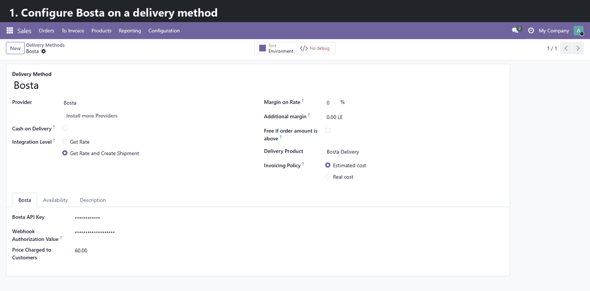
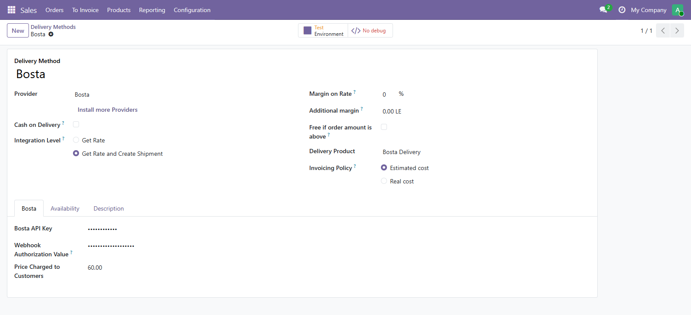
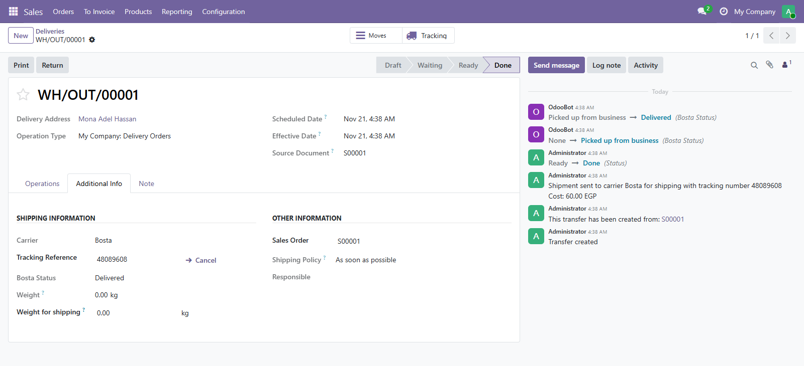
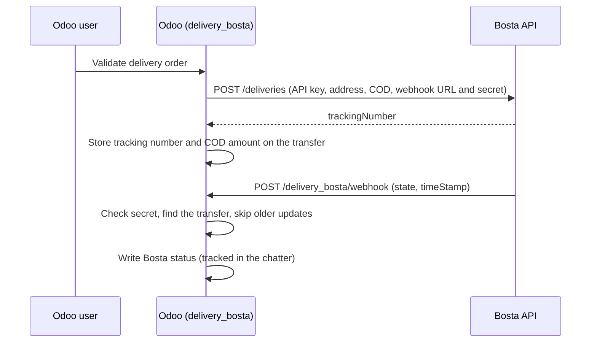

# Bosta Shipping Integration for Odoo 19

[](https://github.com/Yahiasherif002/odoo-delivery-bosta/actions/workflows/ci.yml)

An Odoo 19 delivery carrier integration for [Bosta](https://bosta.co), an Egyptian courier. Merchants create Bosta
shipments from Odoo delivery orders, collect cash on delivery, track parcels, and get Bosta's delivery statuses back
in Odoo through webhooks.

## Features

- Bosta as a provider on Odoo delivery methods
- Shipment creation when a delivery order is validated
- Cash on delivery for orders paid with Odoo's Cash on Delivery payment method
- Tracking number on the transfer and a link to Bosta's tracking page
- Delivery status updates from Bosta webhooks, recorded on the transfer and in its chatter
- Address validation before sending, and Bosta's error message shown when it rejects a shipment
- 23 automated tests, run in CI on Odoo 19 and PostgreSQL 16

## Demo



| Delivery method settings | Transfer after Bosta's updates |
| --- | --- |
|  |  |

Recorded on a local Odoo 19 against the Bosta stand-in in [`demo/`](demo/), so you can reproduce it without a Bosta
account (see [Try it locally](#try-it-locally)).

## Architecture



- **Extends Odoo's delivery carrier framework.** The module adds `bosta` to `delivery.carrier.delivery_type` and
  implements the hooks Odoo calls for each provider: `bosta_rate_shipment`, `bosta_send_shipping`,
  `bosta_get_tracking_link`, and `bosta_cancel_shipment`. Odoo's own `stock_delivery` code decides when to call them,
  so validation, "Send to Shipper", the tracking button, and invoicing of the shipping cost work as for any carrier.
- **Uses the Odoo ORM for its data.** Three fields on `delivery.carrier` (API key, webhook secret, both restricted to
  administrators) and three on `stock.picking` (Bosta status, the time of that status, and the cash amount sent to
  Bosta). The status is a tracked field, so every change appears in the chatter without extra code.
- **Talks to Bosta over HTTP.** One `POST /deliveries?apiVersion=1` per transfer, with the API key in the
  `Authorization` header. The request also registers this database's webhook URL and secret for that delivery, which
  is how Bosta's documented webhook setup works per delivery.
- **Processes webhooks in an authenticated controller.** `/delivery_bosta/webhook` checks the `Authorization` value
  against each Bosta delivery method's secret before reading the body or touching any transfer, then updates only the
  transfers of the delivery method whose secret matched.
- **Tests with mocked HTTP.** Unit tests replace the outgoing request; HTTP tests post real requests to the webhook.

## Installation

Requirements: Odoo 19 (Community or Enterprise). The module depends on `stock_delivery`, which installs Sales,
Inventory, and delivery methods if they are not installed yet.

1. Copy the `delivery_bosta` folder into a directory on your Odoo addons path.
2. Restart Odoo.
3. Turn on developer mode (Settings > Developer Tools > Activate the developer mode, or add `?debug=1` to the URL).
   "Update Apps List" only appears in developer mode.
4. Open Apps, click **Update Apps List**, then **Update**.
5. Remove the **Apps** filter from the search bar (this module is not a standalone app, so that filter hides it),
   search for **Bosta Shipping**, and click **Activate**.

These steps were checked on a fresh Odoo 19 database.

## Configuration

1. In your Bosta dashboard, go to Settings > API Integration and create an API key. A key with Read/Write access is
   enough, since Odoo only creates deliveries.
2. In Odoo, go to Inventory > Configuration > Delivery > Delivery Methods and create a delivery method with the
   provider **Bosta**.
3. On the **Bosta** tab, paste the API key, enter a webhook Authorization value (any long random string), and set the
   price charged to customers.
4. On the **Availability** tab, limit the method to Egypt.
5. Make sure Bosta can reach your Odoo: the `web.base.url` system parameter must be your public HTTPS address, and if
   the server hosts several databases, use `dbfilter` so that address serves exactly one database. Without that, Odoo
   cannot route the webhook to a database and answers 404.

Optional: the `delivery_bosta.api_url` system parameter replaces the Bosta API address (default
`https://app.bosta.co/api/v2`), for example to point at a test server.

## Usage

1. On a quotation, click **Add shipping**, pick the Bosta method, and confirm the order.
2. Validate the delivery order. Odoo sends it to Bosta and stores the tracking number under **Additional Info**. The
   **Tracking** button opens Bosta's tracking page. (This happens on validation when the operation type has "Generate
   Shipping Labels" enabled, which is the default for delivery orders. Otherwise click **Send to Shipper**.)
3. If the customer chose Cash on Delivery at checkout, Bosta is told to collect the order total.
4. As Bosta moves the parcel, the **Bosta Status** field and the chatter update: picked up, received at warehouse,
   delivered, returned, and so on.

## Failure handling and retries

- **No automatic retries.** Each transfer gets exactly one request with a 30-second timeout. Bosta documents no
  idempotency key, so retrying on its own could create a second delivery.
- **When Bosta rejects a shipment**, its message is shown and nothing is stored. Validating a single transfer stops
  there: fix the data and validate again. When several transfers are validated together, Odoo keeps the ones already
  sent and puts a warning activity on the failing one; fix it and click **Send to Shipper**.
- **When Bosta does not answer in time**, the delivery may still exist on Bosta's side. The error says so and gives
  the business reference (for example `S00001 WH/OUT/00001`) to search for in the Bosta dashboard before sending
  again.
- **Duplicate shipments.** Odoo only sends transfers without a tracking number, and hides "Send to Shipper" once one
  exists. The remaining risk is a delivery Bosta created but Odoo never recorded: a timeout, or a later error that
  rolled back the validation. The business reference makes those easy to find.
- **Repeated webhooks are harmless.** The same status twice changes nothing, an update older than the stored one is
  ignored (by Bosta's `timeStamp`), and an update for an unknown delivery gets a 200 with `"ignored"`.

## Security

- The webhook compares the `Authorization` header with each Bosta delivery method's secret in constant time, before
  any other work. A wrong value gets a 401 whether or not the delivery exists, and one method's secret cannot update
  another method's deliveries.
- Bodies over 64 KB get a 413 and malformed bodies a 400. Unknown state codes are stored as `State <code>`, cut to a
  short length.
- Bosta's webhook scheme is a static header with no signature, so a captured request could be replayed. Replays can
  only repeat a status (no change) or send an older one (ignored by timestamp). Serve Odoo over HTTPS.
- The API key and webhook secret are visible to administrators only and are never logged. With the delivery method's
  "Debug logging" option on, Odoo logs the request without the webhook secret, plus Bosta's response. The request
  still contains the customer's name, phone, and address, so only enable debug logging while troubleshooting.

## Testing

23 tests cover the request sent to Bosta, the configurable API address, cash on delivery (including backorders not
collecting twice), single and multiple tracking links, address validation, Bosta errors, timeouts, log redaction,
and the webhook: valid updates, chatter author, repeats, out-of-order and replayed updates, transfers with several
tracking numbers, unknown states, wrong secrets, cross-carrier secrets, unknown deliveries, and malformed and oversized
bodies. The guards for webhook authentication, out-of-order updates, cash collection, and log redaction were each
removed once to confirm a test fails without them.

```bash
docker compose up -d db
docker compose run --rm odoo odoo -d test -i delivery_bosta --test-tags /delivery_bosta --stop-after-init
```

CI runs the same command on every push and fails unless all tests pass.

### Try it locally

The `demo` profile adds a small stand-in for Bosta's create-delivery endpoint, and `demo/seed.py` creates a Bosta
delivery method, a customer in Cairo, a product, and a confirmed order:

```bash
docker compose down
docker compose up -d db
docker compose run --rm odoo odoo -d demo -i sale_management,delivery_bosta --stop-after-init
docker compose --profile demo up -d odoo bosta-mock
python demo/seed.py
```

`docker compose down` starts from an empty database server, so `demo` is the only database and the webhook can be
routed. Log in at http://localhost:8069 as `admin` / `admin`, open the delivery order, and validate it (if Odoo asks
about confirming by SMS, choose "Disable SMS"). Then send a status update the way Bosta would:

```bash
curl -X POST http://localhost:8069/delivery_bosta/webhook \
  -H "Content-Type: application/json" -H "Authorization: demo-webhook-secret" \
  -d '{"trackingNumber": 48089608, "state": 45, "timeStamp": 1763710000000}'
```

## Limitations

- **Not yet validated against a live Bosta account.** The requests and webhook payloads follow Bosta's public
  documentation and are tested against mocks.
- **Cancelling from Odoo is not supported.** Bosta's public docs do not show the path of its terminate endpoint, so
  the module does not guess it; Odoo's Cancel button explains this. Cancel in the Bosta dashboard, and the
  cancellation arrives through the webhook.
- **Rates** use the delivery method's fixed price, because Bosta prices depend on each business's contract.
- **Addresses** send the governorate (or city) and street lines only, without district or zone IDs. The city must be
  a name Bosta recognises, such as Cairo, Giza, or Alexandria; otherwise Bosta answers "City Not Found" and the
  module shows that message.
- **Cash on delivery** collects the remaining order total on an order's first shipment. Later shipments of the same
  order collect nothing; amounts are not split per shipment.
- **Only standard deliveries** (Bosta type 10). Exchanges, customer returns, and cash collection orders are not covered,
  and package size and weight are not sent.
- **No automatic retries** and **no replay-proof webhooks**, for the reasons above.

## Repository layout

| Path | Contents |
| --- | --- |
| `delivery_bosta/models/delivery_carrier.py` | The Bosta provider: rate, send, tracking link, cancel, and the request payload |
| `delivery_bosta/models/stock_picking.py` | Bosta status, status time, and cash amount on transfers |
| `delivery_bosta/controllers/main.py` | The webhook that receives Bosta's status updates |
| `delivery_bosta/views/` | The Bosta tab on delivery methods and the status on transfers |
| `delivery_bosta/tests/` | Unit and HTTP tests |
| `demo/` | The Bosta stand-in and seed script used for the demo |
| `docs/` | Screenshots and the demo GIF |

## License

LGPL-3.0, the same license as Odoo Community.
